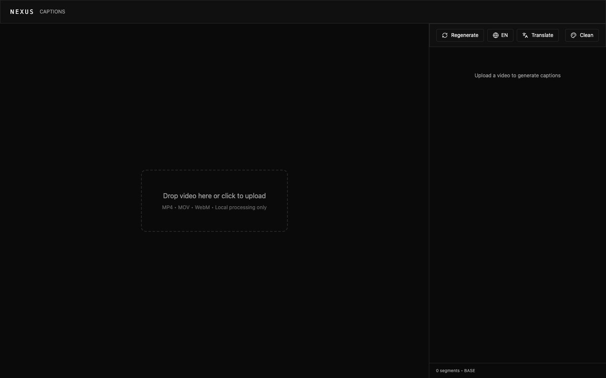
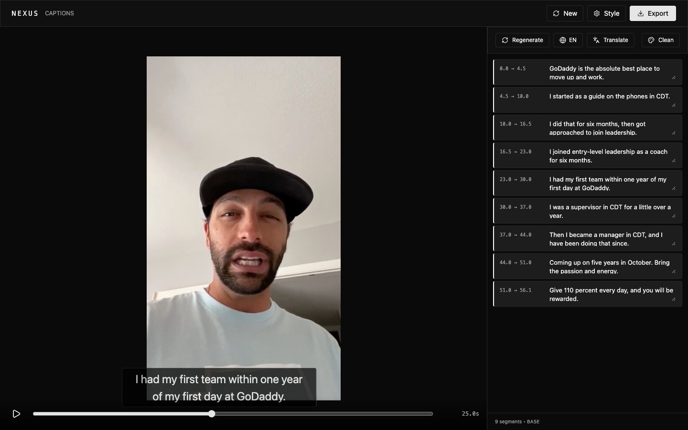

# Nexus Captions

A local-first AI video caption editor. Everything runs in the browser — video never leaves the machine, and there is no backend.



## How it works

1. **Upload** an MP4, MOV, or WebM file via drag-and-drop.
2. **Transcribe** on-device with Whisper (Transformers.js, tiny/base models downloaded and cached on first use).
3. **Edit** timestamped segments inline, with the active caption highlighted during playback.
4. **Style** captions from 5 built-in presets, or tune them live in the style sider.
5. **Export** an `.srt` file, a video with captions baked in (WebM), or both.

Once a video is loaded, segments stay editable inline while the preview plays in sync:



## Features

- Split-view editor: live video preview with synced caption overlay + editable segment list
- Caption style presets with a slide-in style editor and saving
- Keyboard shortcuts: `Space`/`K` play-pause, `←`/`→` seek 10s, `Cmd+S` export, `Esc` closes panels
- LocalStorage persistence of captions and selected preset
- Installable PWA with offline support (service worker disabled in dev)
- Browser capability checks with clear error messaging

## Tech stack

- **Framework**: Astro 7 + React 19
- **Styling**: Tailwind 4 with a custom `@theme` design system (neutral dark, no arbitrary values)
- **State**: Zustand
- **AI**: `@huggingface/transformers` (Whisper, main thread; worker file prepared)
- **Video**: MediaBunny + Canvas/MediaRecorder for baked export
- **PWA**: `@vite-pwa/astro`
- **Tests**: Vitest + Testing Library

## Getting started

Requires Node `>=22.12` and pnpm, plus a modern browser with MediaRecorder and Web Audio support.

```sh
pnpm install
pnpm dev
```

Then open http://localhost:4321/.

> If `pnpm install` refuses with `ERR_PNPM_IGNORED_BUILDS`, run `pnpm approve-builds` and allow the listed packages (esbuild, onnxruntime-node, protobufjs).

## Commands

| Command         | Action                                      |
| :-------------- | :------------------------------------------ |
| `pnpm dev`      | Start dev server at `localhost:4321`        |
| `pnpm build`    | Build production site to `./dist/`          |
| `pnpm preview`  | Preview the production build locally        |
| `pnpm test`     | Run tests in watch mode                     |
| `pnpm test:run` | Run tests once                              |
| `pnpm lint`     | Lint everything (must stay at 0 errors)     |
| `pnpm astro …`  | Run Astro CLI commands                      |

## Project structure

```text
├── docs/
│   ├── HANDOVER.md          # Detailed handover notes for AI agents
│   ├── designs/             # UI reference mockups
│   └── screenshots/         # Live app screenshots
├── public/                  # Static assets
├── src/
│   ├── components/          # App shell, VideoPreview, CaptionEditor, PresetSider, PWAInstallPrompt
│   ├── lib/                 # Whisper transcription + SRT/baked-video export (+ tests)
│   ├── pages/index.astro    # Root entry
│   ├── stores/              # Zustand app store (+ tests)
│   ├── styles/              # Tailwind design-system tokens
│   ├── workers/             # Whisper worker (prepared, not yet wired in)
│   └── types/               # Shared TypeScript types
└── package.json
```

## Status and next steps

Core features are implemented and lint/test gates are green. The main known gaps (see [HANDOVER.md](docs/HANDOVER.md)):

- Whisper still runs on the main thread; wire up `src/workers/whisper.worker.ts`
- Baked export uses Canvas + MediaRecorder (WebM only); a full MediaBunny pipeline would enable MP4 and better quality
- Audio extraction and export cancellation need hardening for long videos

## Conventions

- TypeScript strict, zero `any`, ESLint clean
- No Tailwind arbitrary values — add tokens to `@theme` instead
- Keep the neutral dark palette (no cyan/magenta)
